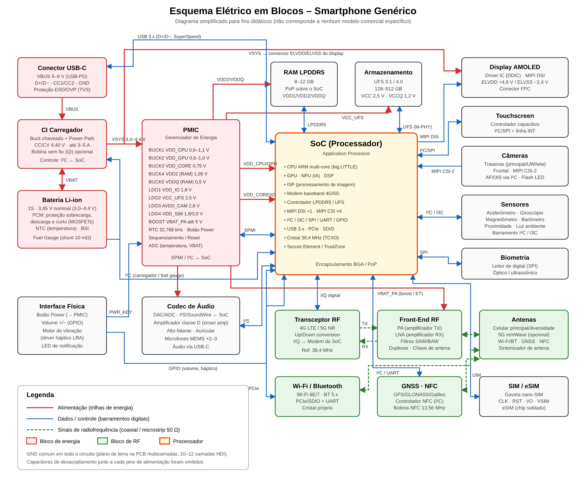

# Esquema Elétrico de um Celular (Smartphone)

Diagrama elétrico **em blocos** de um smartphone genérico, mostrando como a
energia e os sinais circulam entre os principais componentes.



- `esquema-celular.svg`: versão vetorial (editável, zoom sem perda)
- `esquema-celular.png`: versão em imagem

> **Observação:** o esquema completo de um celular comercial tem milhares de
> componentes, ocupa dezenas de páginas e é documentação confidencial do
> fabricante. Este é um diagrama didático que mostra a arquitetura típica.

---

## 1. Caminho da energia (linhas vermelhas)

```
USB-C (5–9 V) ──► CI Carregador ──► VSYS (3,4–4,4 V) ──► PMIC ──► trilhas do SoC, RAM, UFS, câmeras...
                       ▲
                       ▼
                Bateria Li-ion 3,85 V
```

| Bloco | Função |
|---|---|
| **Conector USB-C** | Entrada de energia (VBUS) e dados. Pinos CC negociam a tensão via USB Power Delivery. Diodos TVS protegem contra ESD/sobretensão. |
| **CI Carregador** | Conversor buck que carrega a bateria em modo CC/CV (corrente constante → tensão constante até 4,40 V). O *power-path* alimenta o sistema (VSYS) mesmo com a bateria descarregada. |
| **Bateria Li-ion** | Célula única (1S). Tem placa de proteção (PCM) com MOSFETs, termistor NTC e *fuel gauge* que mede a corrente por um resistor shunt para calcular a % de carga. |
| **PMIC** | Gera todas as tensões do aparelho a partir do VSYS usando conversores buck (alta corrente, ex.: CPU) e LDOs (baixo ruído, ex.: câmeras). Controla a sequência de liga/desliga, o RTC e o botão Power. |

### Principais trilhas de alimentação

| Trilha | Tensão típica | Alimenta |
|---|---|---|
| VDD_CPU / VDD_GPU | 0,6 – 1,1 V (dinâmica, DVFS) | Núcleos do processador e GPU |
| VDD_CORE | 0,75 V | Lógica interna do SoC |
| VDD2 / VDDQ | 1,05 V / 0,5 V | Memória LPDDR5 |
| VDD_IO | 1,8 V | Pinos de I/O, sensores, I²C |
| VCC_UFS | 2,5 V | Armazenamento UFS |
| AVDD_CAM | 2,8 V | Parte analógica das câmeras |
| VDD_SIM | 1,8 / 3,0 V | Cartão SIM |
| VBAT_PA | até 5 V | Amplificador de potência de RF |
| ELVDD / ELVSS | +4,6 V / −2,4 V | Painel AMOLED |

## 2. Dados e controle (linhas azuis)

| Barramento | Ligação |
|---|---|
| **LPDDR5** | SoC ↔ RAM (montada em PoP, empilhada sobre o SoC) |
| **UFS (MIPI M-PHY)** | SoC ↔ armazenamento interno |
| **MIPI DSI** | SoC → display |
| **MIPI CSI-2** | Câmeras → SoC |
| **I²C / I3C / SPI** | Touch, sensores, carregador, NFC, leitor de digital |
| **SPMI** | SoC ↔ PMIC (controle de tensões) |
| **I²S / SoundWire** | SoC ↔ codec de áudio |
| **PCIe / SDIO** | SoC ↔ Wi-Fi/Bluetooth |
| **USB 3.x** | Conector USB-C ↔ SoC |
| **GPIO** | Botões de volume, motor de vibração, LEDs |

## 3. Radiofrequência (linhas verdes tracejadas)

```
Modem (SoC) ⇄ Transceptor RF ⇄ Front-End (PA / LNA / filtros / duplexer) ⇄ Antenas
```

- **Transceptor**: converte o sinal digital I/Q do modem para a frequência de
  rádio (TX) e vice-versa (RX).
- **Front-End**: o PA amplifica a transmissão; o LNA amplifica a recepção;
  filtros SAW/BAW e duplexers separam as bandas.
- **Antenas**: várias antenas (principal, diversidade, Wi-Fi/BT, GNSS, NFC),
  normalmente integradas à moldura metálica do aparelho.

## 4. Demais blocos

- **Display AMOLED + Touch**: painel com driver próprio (DDIC) e controlador de
  toque capacitivo que gera interrupção (INT) para o SoC.
- **Câmeras**: sensores CMOS com autofoco/estabilização (OIS) controlados por I²C.
- **Sensores**: acelerômetro, giroscópio, magnetômetro, barômetro, proximidade
  e luz ambiente.
- **Áudio**: codec com DAC/ADC, amplificador classe D, alto-falante, auricular
  e microfones MEMS.
- **SIM / eSIM**: interface UIM (CLK, RST, I/O, VSIM).
- **Interface física**: botão Power (vai direto ao PMIC para ligar o aparelho),
  volume, motor háptico.

## 5. Sequência de ligação (power-on)

1. Usuário pressiona o botão Power → PMIC detecta pelo pino `PWR_KEY`.
2. PMIC verifica a tensão da bateria (VBAT) e liga as trilhas em ordem
   (VDD_CORE → VDD_IO → memória → CPU).
3. PMIC libera o `RESET` do SoC; o cristal de 38,4 MHz começa a oscilar.
4. SoC executa o *boot ROM*, lê o bootloader do UFS e carrega o sistema
   operacional na RAM.
5. O sistema inicializa display, modem e demais periféricos.

## Dica para manutenção

Na bancada, os pontos mais medidos são: **VBUS** (entrada USB), **VBAT**,
**VSYS** e as saídas do **PMIC**. Um curto em uma dessas trilhas (detectado
com fonte de bancada + câmera térmica ou álcool isopropílico) é a causa mais
comum de "celular não liga".
